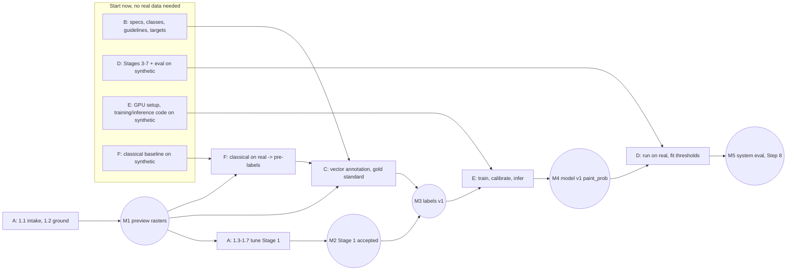

# Roadmap

How we get from delivered point clouds to reviewed, typed vector road markings. It follows the
handoff (`docs/handoff.md`, section numbers like §4.2 refer to it).

The handoff's development sequence (§12) is written as one line of steps. In practice most of
the work depends only on **interfaces**, not on real upstream results, so it runs as **six
parallel tracks** that meet at **milestones**. The steps below (1–8) keep their technical
content; each one is tagged with its track.

**Rules**

- A unit of work is finished when its **acceptance check** passes and `docs/DECISIONS.md` has an
  entry (parameters + reasoning, never coordinates or data).
- Precision first (§1.2): when in doubt, output `unknown` or flag for review. Never loosen
  acceptance criteria to gain recall.
- Everything is developed and unit-tested on the **synthetic scene** first, then run on real
  data **locally**. Real data, results and screenshots never enter git or any web service
  (`DATA_POLICY.md`).
- Interfaces (below) are frozen. Changing one needs a PR that updates the contract, both sides'
  code and tests in the same change.

---

## 1. Tracks, machines, milestones

| Track | What | Roadmap content | Machine | Can start | Real-data gate |
|---|---|---|---|---|---|
| **A** Data foundation | point cloud → accepted channel rasters | Step 1 | CPU (this PC) | as soon as data arrives | (it creates M1, M2) |
| **B** Specs | verify the standard, freeze classes, guideline text, acceptance targets, split strategy | 1.0, Step 2 (text) | none | **now** | none |
| **C** Annotation | training labels + vector gold standard in QGIS | Step 2 (labels) | CPU / QGIS | at **M1** (+ B's draft guidelines) | M1 |
| **D** Downstream algorithms | elements, assembly, GeoPackage, QA rules, eval metrics | Steps 5 (rules), 6, 7, eval | CPU | **now**, on synthetic + simulated `paint_prob` | M4 for real results |
| **E** Model | segmentation training, tiled inference, calibration; glyph CNN | Steps 4, 5 (glyph CNN) | **GPU machine** | **now**, smoke tests on synthetic | M3 for real training |
| **F** Classical baseline | intensity threshold floor + pre-labels | Step 3 | CPU | **now** on synthetic | M1 |



| Milestone | Definition | Unblocks |
|---|---|---|
| **M0** Interfaces frozen | the contracts in §2 below. Done in code. | all tracks work independently |
| **M1** Preview rasters | Stage 1 run on the pilot areas with provisional parameters (after 1.1 and a first pass of 1.2) | C starts annotating; F runs on real data |
| **M2** Stage 1 accepted | Step 1 acceptance passed; final pixel size, intensity model, road mask | final rasters for all areas; label rasters regenerated from the vectors (no re-annotation) |
| **M3** Labels v1 | train + val annotation done, gold standard on test, agreement measured | real model training (E), threshold fitting (D) |
| **M4** Model v1 | calibrated `paint_prob` on val/test, seam test passed | D on real data; Step 7 thresholds |
| **M5** System evaluation | Step 8 on held-out test areas | iteration by error cause |

**Critical path:** A to M1, then annotation (C, the biggest human effort), then M3, then training
(E), then M4, then D on real data, then M5. Ways to shorten it:

1. Start B now so the guidelines are ready on the day M1 lands.
2. Reach M1 early with provisional parameters. Don't wait for Stage 1 to be perfect, because
   annotation is done as vectors and survives later changes of grid and intensity.
3. Use F's pre-labels so annotators correct rather than draw.
4. Have D and E finished on synthetic data before their gates open, so M3 and M4 turn into runs
   instead of development.

**If one person does everything**, the order is the same. Fill every wait (data delivery,
annotation sessions, training runs) with D, E or F work on synthetic data.

---

## 2. Interface contracts (M0)

| # | Contract | Producer → consumer | Defined in |
|---|---|---|---|
| I1 | Channel rasters: names, dtypes, NaN/0 no-data semantics, one snapped grid, COG. Produced by Stage 1 or by the raster adapter (1.8). The adapter writes channels it can't recover as all-NaN and records each channel's meaning in `manifest.json → channels` | A → C, D, E, F | `stage1_raster/rasterize.py::CHANNELS`, `io/raster.py::Grid` |
| I2 | `paint_prob.tif`: float32 in [0, 1], **NaN where coverage = 0**, same grid as I1; optional `paint_class.tif` uint8 (aux classes §5.1) | E, F → D | this table; `synthetic.simulate_paint_prob` is the reference fake |
| I3 | Annotations are **vectors in the project CRS** (GeoPackage in `<data_root>/annotations/`): `paint` polygons with class, `ignore` polygons, `split_area` polygons (train/val/test); the gold standard uses the §8.2 schema | B, C → E, F, D, eval | `io/labels.py` (rasterize on any grid), `stage5_vector/schema.py` |
| I4 | Paint elements | D internal | `stage3_elements/elements.py::PaintElement` |
| I5 | Tracks + s-intervals | D internal → output | `stage4_assembly/track.py` |
| I6 | Output GeoPackage layers | D → review, eval | `stage5_vector/schema.py` |
| I7 | Run folder `<data_root>/runs/<name>/<stage>/` with `manifest.json` (git commit, config hash, input fingerprints) | all | `provenance.py` |
| I8 | Standards file (dimensions, thresholds) | B → D, F | `configs/standards/*.yaml` |

### Two-machine workflow (CPU PC ↔ GPU machine)

- Both machines use the same repo commit, `uv sync` and `uv run pre-commit install`. On the GPU
  machine: `uv sync --extra ground --extra seg-cuda`, then `uv run roadmark env` must show
  `cuda_available: true`.
- **CPU → GPU:** `runs/<name>/stage1/` (rasters + manifest) and `annotations/`.
  **GPU → CPU:** `runs/<name>/stage2/` (`paint_prob.tif` + manifest) and `models/<model>/`.
- Data moves only inside the data boundary (LAN share or encrypted removable disk, by a person;
  see `DATA_POLICY.md`). Integrity is checked with the input fingerprints in each `manifest.json`.
- Code moves only through git. Data never does.

---

## 3. Status

| Step | Title | Track | Status |
|---|---|---|---|
| 0 | Project setup | – | done |
| 1 | Data foundation | A (+B for 1.0) | M1 reached (pilot_a, raster adapter); pixel size and 1.4–1.7 open |
| 2 | Guidelines and gold standard | B, C | not started (B can start now) |
| 3 | Classical reference | F | not started (can start now) |
| 4 | Segmentation model | E | not started (can start now on synthetic) |
| 5 | Paint elements and glyphs | D (rules), E (glyph CNN) | not started (can start now on synthetic) |
| 6 | Object assembly | D | not started (can start now on synthetic) |
| 7 | Vector output and QA | D | not started (can start now on synthetic) |
| 8 | Full evaluation and iteration | all | after M4 |

---

## Step 0: Project setup (done)

- [x] Repository layout per §11.3, Python 3.12 with uv, lockfile
- [x] Data-leak protection: `.gitignore`, data guard (pre-commit, pre-push, CI), Claude Code
      permission rules, `DATA_POLICY.md`
- [x] Typed configs (pipeline, standard). Data root defaults to `<repo>/data`
      (`roadmark init`).
- [x] Synthetic MLS scene with known truth. Stage 1 runs end-to-end on it.
- [x] Interfaces I1–I8. Vector→raster labels (`io/labels.py`), simulated `paint_prob`.
- [x] PyTorch extras: `seg-cuda` (CUDA 13.0, GPU machine) and `seg-cpu` (smoke tests)

**Each machine, once per clone:**

```powershell
uv sync --extra ground                 # GPU machine: add --extra seg-cuda
uv run pre-commit install --hook-type pre-commit --hook-type pre-push
uv run roadmark init                   # creates <repo>/data layout
uv run roadmark env                    # GPU machine: check cuda_available
uv run pytest
```

---

## Step 1: Data foundation: extraction and preprocessing (Track A; §3, §4)

**Goal:** from the delivered point clouds, produce seamless, gap-aware channel rasters
(`int_max`, `int_mean`, `int_p90`, `density`, `coverage`, `hag_max`, `ground_z`) plus a
road-surface prior, with intensity that is consistent across ranges and scan passes.

**Acceptance check (§12.1), which closes M2:**
1. Cross-pass intensity consistency on the same markings within the agreed tolerance
   (`qa_stage1.json → cross_pass_consistency.passed`).
2. The density/coverage channel separates occlusions from observed ground: sampling no-data on
   observed road < 2 % of cells, and every occlusion (vehicle, pole shadow) shows as contiguous no-data.
3. Visual check in QGIS on 3 pilot areas: no paint lost by ground filtering, curbs found.

**M1 (preview) is reached after 1.1 and a first pass of 1.2.** Run Stage 1 with default
parameters on the pilot areas and hand the rasters to Tracks C and F. Keep tuning 1.2–1.6 while
annotation runs.

### 1.0 Confirm inputs and open decisions (Track B; §3, §14)

Record decisions in `docs/DECISIONS.md`. Values that reveal the project stay in `configs/local/`.

- [ ] Source point cloud available (strongly preferred over pre-flattened rasters, §4.6)
- [ ] Point attributes: intensity (required); GPS time, pass/source ID, scanner position or
      range, RGB (`roadmark inspect` reports them)
- [ ] Trajectory / SBET file and its time base (GPS week seconds vs. adjusted standard time)
- [ ] CRS: projected metric EPSG for all outputs
- [ ] Jurisdiction and standard edition. `configs/standards/gb5768_3_2009.yaml` holds **draft,
      unverified** values. Check each one against the text, add the missing dash patterns,
      record clause numbers, then set `verified: true`.
- [ ] Paint colour required? If yes, RGB is mandatory (§3).
- [ ] Number of scan passes per area
- [ ] GPU machine: inside the data boundary (owned/controlled, not cloud); NVIDIA driver ≥ 580
      for the cu130 wheels, otherwise switch to cu126 in `pyproject.toml`
- [ ] Pilot areas: 3 small areas (~200 m each): a straight road with dashed lines, a
      signalised intersection with crosswalks and arrows, and a street with parked cars and curbs
- [ ] Per-class acceptance targets with the project owner (§10.3)

### 1.1 Data intake and inventory

- [x] Copy deliveries to `<data_root>/raw/` and make them read-only.
- [x] `uv run roadmark inspect data/raw/*.laz` → inventory (redacted: counts, density, extent
      size, EPSG, attributes).
- [x] Extend `inspect`: pass-ID histogram, GPS-time range per pass, classification histogram,
      intensity percentiles. Done as `roadmark inventory NAME=GLOB ... --name <run>`
      (`io/inventory.py`).
- [ ] Check CRS consistency; reproject upstream if needed, never inside the pipeline.
      (First delivery has no CRS in its headers.)
- [x] The point delivery (`thin_result`) is thinned to ~16 pts/m² on the ground, with no passes
      or GPS time, and no originals exist. It is the 3D reference only (DECISIONS 2026-10-26).
- [x] No CRS will ever be known: work in the delivered local grid (`allow_local_crs: true`).

### 1.2 Ground filtering (§4.1)

- [ ] On the pilot areas compare `existing` vs `csf` (`grid_min` only as a sanity floor).
- [ ] Checks: (a) **paint must be ground**: bright points classified non-ground ≈ 0;
      (b) vehicles, pedestrians, bins must be non-ground; (c) curb tops and islands should be ground.
- [ ] Tune CSF if used. Keep low non-ground (HAG ≤ 0.30 m) for curbs.
- [ ] **First usable result → run Stage 1 → M1.**

### 1.3 Scanner geometry

- [ ] Load the trajectory (`stage1.trajectory.path`: t, x, y, z) and find the time offset to LAS
      `gps_time`.
- [ ] Sanity check: the minimum range per pass ≈ scanner height above road. Ranges vary smoothly.
- [ ] If there is no trajectory: (a) obtain it (preferred), or (b) per-pass normalisation only,
      documented as leaving range effects in.

### 1.4 Pixel size and coverage threshold

Synthetic run: 3.75 points/pixel with `coverage_min_points: 2` gives **11 % false no-data**
from Poisson sampling alone. Choose from the measured density:

| coverage_min_points | λ = expected points/pixel for < 1 % sampling no-data | ground density needed at 2.5 cm | at 3 cm |
|---|---|---|---|
| 1 | ≥ 4.6 | ≥ 7 400 pts/m² | ≥ 5 100 pts/m² |
| 2 | ≥ 6.6 | ≥ 10 600 pts/m² | ≥ 7 400 pts/m² |

- [ ] Ground density histogram on the road surface per pilot area.
- [ ] Choose pixel size (2–3 cm) and `coverage_min_points` so sampling no-data on observed road
      is < 2 %.
- [ ] Occlusion layer: no-data blobs above a minimum area, distinct from isolated sampling holes
      (TODO in `stage1_raster/qa.py`).

### 1.5 Intensity correction (§4.2)

- [ ] Inspect `qa_stage1.json → intensity_model`. On flat roads range and incidence are
      collinear (`identifiable: false`, only `a + b` determined). Record which case applies.
- [ ] No remaining trend of asphalt intensity vs range or incidence after correction.
- [ ] Per-pass gains plausible and stable along the area.
- [ ] Agree the consistency tolerance (default 10 % median relative difference on paint interiors).
- [ ] If consistency fails, look for: a wrong time offset, several sensors per pass (normalise per
      sensor), or saturation/auto-gain.

### 1.6 Road-surface prior (§4.4)

- [ ] Tune the curb parameters. Check medians, islands and lowered curbs. The mask is a
      **prior**: paint outside it is flagged, never deleted.
- [ ] TODO(scale): coarse-grid mask for large areas.

### 1.7 Production run and visual QA, closing M2

- [ ] Run on all areas (train/val/test) with the chosen config. QGIS project in the data root.
- [ ] Walk the acceptance checks and record them in DECISIONS.md. Regenerate label rasters from
      the vectors on the final grid.

### 1.8 Only pre-flattened rasters available? (§4.6)

**This is the project's case.** The delivered 3 cm raster tiles (`raw/raster_grid_g/`) are the
primary input (DECISIONS 2026-10-26, Step 1.8).

- [x] Raster inventory and cross-check: grid, no-data encoding, registration with the points
      (`roadmark raster-inventory`, `roadmark crosscheck`).
- [x] Adapter raster tiles → I1 channels: half-pixel origin fix, overlap mosaic, NaN no-data,
      manifest. **This reaches M1.** Code done and exact on synthetic tiles
      (`roadmark adapt-rasters`, `stage1_raster/raster_adapter.py`). Pilot `pilot_a` (2 × 2
      tiles): overlaps identical, visual check in QGIS passed. **M1 reached.**
- [ ] Pixel size: 3 cm vs 6 cm aggregation by the sampling no-data rate (1.4).
- [x] Channel semantics, inferred (`roadmark probe-channels`): density = 5.1 × count (sat. 50),
      intensity = per-pixel max × 255/45 (sat. 45), height not usable (DECISIONS 2026-10-26).

- [ ] No reliable density: treat all dash gaps as lower-confidence evidence and expect a higher
      review rate. Measure the brightness consistency of known markings. Keep pushing for the point cloud.

---

## Step 2: Guidelines and gold standard (Track B text, Track C labels; §1.3, §5.5, §5.6)

**Acceptance (closes M3):** inter-annotator IoU and boundary agreement measured,
disagreements resolved into the guidelines, gold standard complete on the test areas.

Track B, **start now**:
- [ ] Freeze the class list (§1.3) and symbol types (`symbols.classes`).
- [ ] `docs/annotation_guidelines.md`: what counts as paint, boundary placement (outer edge),
      occluded → `ignore`, every class with edge cases. Illustrate with synthetic images in the
      public repo; a version with real crops lives in the data root.
- [ ] Split strategy: whole intersections / road sections, never tiles. The test set covers
      campaigns, worn paint, occlusion, curves, complex intersections and every class.
- [ ] QGIS annotation project template with the I3 layers and the §8.2 gold schema.

Track C, **from M1**:
- [ ] Draw `split_area` polygons, then annotate train/val as vectors (start from F's pre-labels).
- [ ] Double-annotate ~10 %, compute agreement (`eval/`), and update the guidelines.
- [ ] Vector gold standard on test areas: tracks with s-intervals, crosswalks, stop lines,
      symbols with type and heading.

## Step 3: Classical reference (Track F; §12.3)

**Acceptance:** floor metrics on val. Every later model must beat it at equal or better precision.

- [ ] **Now, synthetic:** `stage2_segment/classical.py`: paint score = corrected intensity contrast
      vs asphalt, hysteresis, morphology, size filter. No-data never becomes paint. Output
      follows contract I2.
- [ ] **From M1:** run on pilot areas, export pre-labels as vectors (I3) for Track C.
- [ ] After D has a minimal Stages 3–5: measure the floor end-to-end.

## Step 4: Segmentation model (Track E, GPU machine; §5)

**Acceptance (closes M4):** pixel metrics beat the classical floor at the precision target,
and the seam test passes.

**Now, on synthetic data:**
- [ ] E0 GPU machine setup: clone, `uv sync --extra ground --extra seg-cuda`, pre-commit,
      `roadmark init`, `roadmark env` shows CUDA.
- [ ] Dataset: tiles from stitched I1 rasters plus labels rasterized from I3 vectors
      (`io/labels.py`). **Global** normalisation statistics; no-data → ignore label (255).
- [ ] Model: high-resolution output (U-Net/SegFormer with a high-res decoder, or HRNet).
      Inputs `int_max`, `int_mean`, log `density`, optional `hag_max`/RGB.
      Loss BCE + Dice + clDice/boundary; auxiliary coarse-class head.
- [ ] Tiled inference: 1024 px tiles, cosine blend, TTA (`stage2_segment/tiling.py`). Overlap
      from the half-tile-shift test, then the seam test. Output follows I2.
- [ ] Temperature-scaling calibration, threshold selection at a target precision.
- [ ] Training runs `require_cuda` (`device.get_device`). Local tracking only (TensorBoard under
      `<data_root>/models/`). The synthetic scene must overfit cleanly as a smoke test.

**From M3:** train on real labels, calibrate on val, write `paint_t_high/low`, produce
`paint_prob.tif` for val/test → M4.

## Step 5: Paint elements and glyphs (Track D rules; Track E glyph CNN; §6)

**Acceptance:** element-level P/R at IoU ≥ 0.5; glyph confusion matrix with open-set rejection.

**Now, on synthetic** (input: `simulate_paint_prob` on the synthetic truth, at several noise
and dropout levels):
- [ ] D0: extend the synthetic scene first: worn paint, solid↔dashed transitions, double lines
      with one side ending, curved guide lines, hatched/chevron areas, waiting zones, more arrow
      types, text. Every case `truth.json` describes is a free regression test for Steps 5–7.
- [ ] Block polygonization with halo, `unary_union` at block edges, centroid ownership.
- [ ] Descriptors (`PaintElement`), structure-tensor direction field + coherence.
- [ ] Fragment repair: collinear, similar width, gap ≤ wear tolerance **or** covered by no-data
      (→ `inferred`). Never across observed no-paint gaps longer than the wear tolerance.
- [ ] Rule typing. Glyph CNN (Track E, GPU): road-aligned metric crops, open-set rejection;
      trained first on synthetic glyphs, then real glyph crops from M3.

## Step 6: Object assembly (Track D; §7)

**Acceptance:** object and attribute metrics (§10.2), first on synthetic truth, then on val after M4.

- [ ] Candidate graph, mutual-best linking, curvature-limited centreline splines.
- [ ] Lateral profiles → single/double sub-lines with independent s-extents.
- [ ] Cross-block linking, **then** longitudinal profiles → solid/dashed/unknown intervals,
      transitions, inferred bridging over short no-data gaps with consistent phase.
- [ ] Crosswalks (`partial` flag), stop lines, symbols (lane, heading), area markings, conflicts,
      residual layer.

## Step 7: Vector output and QA (Track D; §8, §9)

**Acceptance:** precision of the auto-accepted set ≥ the per-class target (§10.3) on held-out
data (after M4).

- [ ] **Now:** GeoPackage writer per `stage5_vector/schema.py`, rule checks, review queue,
      QGIS review project template, eval metrics (`eval/`) against synthetic truth.
- [ ] **After M4:** fit confidence weights and `c_accept`/`c_reject` on val; reliability diagram.
      Reviewed corrections flow back as training and gold data.

## Step 8: Full evaluation and iteration (all tracks; §10)

- [ ] Full metric suite on test areas. Report `unknown` as coverage, not as error.
- [ ] Error analysis by cause (`qa.ERROR_CAUSES`), routed to the responsible track.
- [ ] Optional: learned grouping (GNN), adopted only if it beats the rules at equal or better
      precision (§7.7).
- [ ] OpenDRIVE / Lanelet2 exporters (§8.3).
